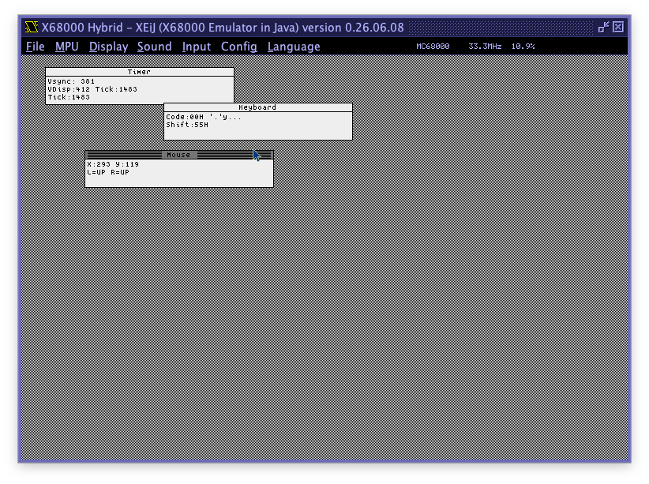

# SSOS for X68000

**SSOS** は X68000（MC68000 プロセッサ）向けの小型オペレーティングシステムである。協調的マルチタスクとプリエンプティブマルチタスクの 2 つのモデルを、ビルド時オプション `SCHED=cooperative|preemptive` で切り替えられる単一の統合ソースツリー（`ssos/`）として実装している。グラフィックス管理、マウス対応ウィンドウシステム、メモリ管理を備える。Human68K 上で動作するスタンドアロン版（`.x`）と、XDF ディスクイメージから直接 IPL 起動するベアメタル版（`.xdf`）の 2 形態でビルド可能。通常 UI は `os/app/scene.c` を `.x` / `.xdf` で共有し、各形式の初期化・終了入口はホスト側に分かれる。スケジューラ本体は `os/kernel/scheduler.c` で共有し、方式別の割り込み処理と起床方針だけを `os/kernel/{cooperative,preemptive}/` で切り替える。

## 教育用 OS として読む

SSOS は単一 CPU・共有アドレス空間・Supervisor mode の task を使う小型 OS である。`.xdf` も IOCS/IPL ROM を利用する。task 切替とプロセスのメモリ保護を区別して学ぶ。

- [設計方針と学習順](docs/educational-os-design.md): 現状評価、責務・依存の改善方針、CPU → scheduler → memory → IPC → UI → 実機の読み順。
- [教育・保守性の改善計画](docs/educational-os-plan.md): 公開 API、host、計測、graphics の段階的な分離と完了条件。
- [文書索引](docs/README.md): 現行契約、検証・測定、既存改善計画、旧実装の履歴。

まず root の `make test` で Native のロジック・RAM 画素を確認できる。QEMU/クロス環境は次の段階で必要になる。以下の詳細なバグ履歴は当時の記録であり、現行の契約は文書索引から参照する。

## 目次

- [教育用 OS として読む](#教育用-os-として読む)
- [前提条件](#前提条件)
- [ビルド](#ビルド)
- [.x / .xdf UI統合の範囲](#x--xdf-ui統合の範囲)
- [メモリマップ](#メモリマップ)
- [ブートフロー](#ブートフロー)
- [アーキテクチャ概要](#アーキテクチャ概要)
- [モジュール依存](#モジュール依存)
- [2 つのマルチタスクモデル](#2-つのマルチタスクモデル)
- [スタンドアロン vs OS モード](#スタンドアロン-vs-os-モード)
- [MFP 割り込み設定](#mfp-割り込み設定)
- [デバッグ](#デバッグ)
- [知見](#知見)
- [テスト](#テスト)
- [参考](#参考)

## 前提条件

macOS: `brew install yunkya2/tap/elf2x68k` でツールチェーンバイナリがインストールできる（XC ライブラリも自動）。
ソースからビルドする場合は <https://github.com/yunkya2/elf2x68k> を参照。
Linux/MinGW: <https://github.com/yunkya2/elf2x68k/releases> からバイナリアーカイブを取得する。

## ビルド

### 環境設定

```bash
export XELF_BASE=/path/to/your/cloned/elf2x68k/m68k-xelf
export PATH=$XELF_BASE/bin:$PATH

# 環境ファイルを読み込む（推奨）
. ~/.elf2x68k
```

### スタンドアロン開発ビルド（テスト推奨）

高速な開発イテレーションのため、Human68K 実行形式としてビルド:

```bash
cd ssos
make standalone SCHED=cooperative
# 出力: ~/tmp/ssos_cop.x （プリエンプティブ版は SCHED=preemptive で ~/tmp/ssos_pre.x）
```

協調版とプリエンプティブ版をまとめて作る場合は、リポジトリルートから実行する。

```bash
cd /path/to/ssos-68k
. ~/.elf2x68k
SS_PROFILE_GFX=1 make all
```

このコマンドは両モデルの `.x` / `.xdf` を生成する。中間成果物は `ssos/{standalone,os,boot}/build/<方式>/` に、ディスクイメージは `ssos/build/disk/<方式>/profile-<値>/` に分離する。公開用コピーは `~/tmp/ssos_{cop,pre}_profile1.{x,xdf}`。通常ビルド（profile 0）は従来の `~/tmp/ssos_{cop,pre}.{x,xdf}` である。コピー先の権限エラーが出ても、各 `build/` 内の成果物は利用できる。

### OS ビルド（起動可能ディスク）

```bash
cd ssos
make SCHED=cooperative
# 出力: ~/tmp/ssos_cop.xdf（起動可能ディスクイメージ。プリエンプティブ版は SCHED=preemptive で ssos_pre.xdf）
```

方式・形式・profile を切り替えても中間ファイルは別ディレクトリなので `make clean` は不要。

### 全ターゲット一括ビルド

ルート Makefile から全ターゲット（`.x` と `.xdf` 両方）を一括ビルドする。引数なしの `make` は Usage を表示する。

```bash
# リポジトリルートで
make -j2 all
# 成果物: ~/tmp/ssos_cop.x, ~/tmp/ssos_cop.xdf, ~/tmp/ssos_pre.x, ~/tmp/ssos_pre.xdf
```

生成された XDF ファイルを X68000 エミュレータで起動:



### グラフィックス性能ベンチマーク

`SS_PROFILE_GFX=1` でビルドしたスタンドアロン版は、Human68K 上で決定的な描画フェーズを測定できる。

```text
ssos_cop_profile1.x -8 -bench 100
cp bench.txt bench-cop.txt

ssos_pre_profile1.x -8 -bench 100
cp bench.txt bench-pre.txt
```

`-8` は 256 色モード、`-bench 100` は各フェーズを 100 回実行する指定である。`bench.txt` は実行時のカレントディレクトリに作成され、毎回上書きされるため、2 つの実行結果を比較する場合は上記のように別名で退避する。

実行順は `full`、`region`、`z-expose`、`text-update`、`drag-region`、`xor-move` である。`drag-region` は固定した 2 位置の間で、実アプリと同じ hide → 旧領域再合成 → XOR → move/show → 新領域再合成を繰り返す。ログの `vsync`、`dma timeout`、`gvram write`、`windows rendered` を同じフェーズ間で比較する。`vsync` は少ないほど速い。`SSPERF file=bench.txt` が表示されれば、ファイルのオープンとクローズまで完了している。

通常操作の実測では、`-bench` を付けずに起動し、Window のドラッグや重なりを試してから ESC で終了する。

```text
ssos_cop_profile1.x -8
cp runtime.txt runtime-cop.txt

ssos_pre_profile1.x -8
cp runtime.txt runtime-pre.txt
```

`runtime.txt` には終了までの `phase=runtime` 集計が保存される。`rounds` は描画 frame 数、`vsync` は計測期間の VSync 数であり、異なる実行時間でも `gvram write / rounds` や `glyph clip / rounds` を比較できる。`-bench` 実行時は従来どおり `bench.txt` だけを出力する。

## .x / .xdf UI統合の範囲

通常操作の UI は、Human68K 版（`.x`）とベアメタル版（`.xdf`）で同じ
`os/app/scene.c` を実行する。3 ウィンドウの生成、入力、ドラッグ、差分本文描画、
z-order、論理パレット、main task 登録は共有である。

| 境界 | 方針 | 理由 |
| :--- | :--- | :--- |
| 通常UI (`scene.c`) | 共有 | 描画・入力・ドラッグの挙動を両成果物で一致させる。 |
| UI task数 | **単一taskに統一** | 旧standaloneの`data_thread`は採用しない。本文更新と描画の同時実行を避け、割込み時の文字列snapshot競合を持ち込まないため。スケジューラ自体の複数task機能は維持する。 |
| UI fixture | 共有 | 3ウィンドウの座標、z、タイトルは`SSSceneWindowSpec`で共有する。 |
| ベンチ実行と出力 | **standalone専用** | `-bench`、`bench.txt`、`runtime.txt`、Human68KファイルI/O、VSync watchdogは`.x`ホストの責務である。`.xdf`へDOS依存を持ち込まない。 |
| ベンチのprimitive描画 | **standalone専用** | 通常UIのcallback描画と混ぜず、既存の性能ベースラインを維持する。ベンチは共有fixtureだけを使い、計測フェーズ自体は共有しない。 |
| 初期化・終了 | ホスト固有 | `.x`はSupervisor移行とHuman68K状態復元、`.xdf`はIPL/CRTC/MFP/固定メモリ初期化を必要とし、共通化しない。 |

この分離は未完了ではなく意図的な設計である。ベンチ実行部の共有や`data_thread`の
再導入は、得られる重複削減よりも、性能基準の変更と並行更新競合のリスクが大きいため
行わない。

### 性能改善の採用結果と今後の計画

現在の 256 色 DMA 成功時の基準値は次の通りである。`drag-region` は重なった Window の固定ドラッグ経路である。

**測定出典**: `4e31dd4` 時点（2026-07-18）の primitive ベンチ（profile 1 版 `.x`、`bench_rounds` 固定シーン）。X68000 エミュレータ上で採取。機種・クロック・エミュレータ種別の個別記録はなく、現行コードでの再計測を推奨する（保守レビュー R14 の注記要件）。

| phase | vsync | DMA状態 |
| :--- | ---: | :--- |
| full | 1019 | `ok=13500 error=0 timeout=0` |
| region | 65 | `ok=4900 error=0 timeout=0` |
| z-expose | 340 | `ok=9000 error=0 timeout=0` |
| drag-region | 314 | `ok=7600 error=0 timeout=0` |
| xor-move | 16 | DMA未使用 |

採用済みの改善:

- DMA の CSR 完了判定、BFC 設定、timeout 時の SAB 停止
- DMA チェインテーブルの偶数アラインメント
- RAM から GVRAM への DMA 転送方向修正（`OCR=0x19`）
- DMA エラーの`CSR/CER`診断ログ
- region 描画の背景・枠・タイトル・本文クリップ
- ドラッグ中の前面切替をタイトルバーだけ再合成し、覆われるタイトル背景 stipple を省略
- damage region 外の本文テキストをスキップ
- XOR 枠の水平辺を 68000 の整列済み long アクセスで処理

固定`drag-region`の改善結果は、初期値 `vsync=554` / `gvram write=8878350` から、`vsync=314` / `gvram write=4634800` になった。VSync は 43.3%、GVRAM 書込みは 47.8%削減し、DMA error/timeout は 0 を維持している。

測定の結果、次の施策は採用しない。

- 16 色モード: `full=1393`で 256 色の`full=1020`より 36.6%遅い
- stipple の DMA 化: 256 色`full=1875`となり、CPU の`ss_fill_long`より遅かった
- 粗い遮蔽情報だけを根拠にした描画 skip 拡大: 部分遮蔽を完全遮蔽と誤判定する危険がある
- 16 色モードでのドラッグ最適化: `drag-region=358`で 256 色より速くならず、full 描画も遅い

完了した測定基盤:

- `render_region`の背景・枠・タイトル・本文の dirty 矩形クリップ
- 通常操作時の`runtime.txt`メトリクス
- 実際の領域再合成経路を測る固定`drag-region`ベンチ

ここまでの数値は過去の primitive ベンチの記録である。現行 scene は z 値の再採番を実装済みで、Native の画素比較で確認する。今後の性能採否と実機確認は[既存改善計画](docs/maintenance-performance-plan-2026-09-30.md)で管理する。

追加の性能候補は、実験用ビルドでのみ検証する。

1. HD63450 の矩形アレイチェイン DMA（行 stride・転送方向・CPU フォールバックを個別に実機検証）
2. damage region を走査線/span へ分割し、最終的に Window で覆われる背景 stipple を描かない
3. 上位の不透明矩形が下位 Window 全体を包含する場合だけ遮蔽 skip する

クリップ化の採用条件は、描画結果を変えずに`region`の`vsync`と GVRAM 書き込み量を削減し、`dma error=0`、`dma timeout=0`を維持することである。

### その他のビルドコマンド

```bash
# ssos/ ディレクトリで（SCHED を指定）
make dump           # バイナリの逆アセンブル出力（デバッグ用）
make readelf        # ELF ファイル情報を表示
make clean          # ビルド成果物を全て削除

# リポジトリルートで
make format         # markdownlint / textlint による自動整形
```

## メモリマップ

SSOS の OS 版（`.xdf`）は X68000 の物理アドレス空間に以下を配置する。

| 領域         | 範囲            | サイズ  | 用途                                                            |
| :---         | :---            | :---    | :---                                                            |
| ブートセクタ | `0x00002000` 〜 | 1KB     | IPL から `boot.X` 1KB をロード（`boot/main.s`）                 |
| OS イメージ  | `0x00010000` 〜 | 192KB   | `.text`+`.rodata` の linker 配置先。boot は sector 2 から 207 KiB をロード |
| RAM          | `0x00040000` 〜 | 80KB    | `.data`+`.bss` 領域。SS_MAX_WINDOWS=32 対応で 64KB→80KB に拡張 |
| Stack pool   | `0x00150000` 〜 | 512KB   | 32 worker × 16KB の専用 stack。heap と分離 |
| OS heap      | `0x001D0000` 〜 | 10432KB | `ss_mem_init` の対象。固定配置は `kernel/linker.ld` が正本 |
| Text VRAM    | `0x00E00000` 〜 | 512KB   | テキスト画面（IPL で使用、OS 起動時に 0 クリア）                |
| GVRAM Page 0 | `0x00C00000` 〜 | 512KB   | 16 色モード (CRTMOD 16) のフレームバッファ                      |
| GVRAM Page 1 | `0x00C80000` 〜 | 512KB   | 256 色モード (CRTMOD 8) のダブルバッファ用                      |
| CRTC         | `0x00E80000` 〜 | —       | 画面制御（V-DISP, スクロール等）                                |
| DMAC Ch.2    | `0x00E84080` 〜 | —       | 矩形塗りつぶし高速化（DMA メモリ→VRAM）                         |
| MFP          | `0x00E88000` 〜 | —       | 割り込みコントローラ（タイマ A〜D, USART, GPIO）                |
| Video Ctl    | `0x00E82600`    | 1 word  | 画面レイヤ ON/OFF。現行 premain は text bit のみクリア                              |

### メモリアロケータ

SSOSRAM 領域は **Buddy + Slab ハイブリッド**アロケータで管理する（`os/mem/`）。

- **Buddy system**（`buddy.c`）: 16B〜64KB（`SS_BUDDY_MIN_ORDER=4`〜`SS_BUDDY_MAX_ORDER=16`）の可変長ブロック。`ss_alloc(size)`/`ss_free(ptr)` で使用
- **Slab cache**（`slab.c`）: 64KB 固定 (`SS_SLAB_SIZE`) の特定サイズ専用キャッシュ。以下の 4 種を事前定義（`memory.h`）

| Slab キャッシュ  | 用途                            |
| :---             | :---                            |
| `ss_slab_task`   | `SSTask` 構造体（タスク管理）   |
| `ss_slab_window` | `SSWindow` 構造体（ウィンドウ） |
| `ss_slab_msg`    | `SSMessage` 構造体（IPC）       |
| `ss_slab_rect`   | 矩形構造体（描画）              |

## ブートフロー

現行 `.xdf` の入口は次の順で進む。ロード配置の正本は `boot/main.s` と `os/kernel/linker.ld` である。

```text
IPL ROM
  → boot/main.s: boot/entry
      IOCS _B_READ で sector 2 から 207 KiB を 0x010000 へロード
      IOCS のマウス初期化後、0x010000 へジャンプ
  → os/kernel/entry.s: entry
      SP を 0x010000 に設定して premain へ
  → os/kernel/premain.c: premain
      BSS clear → IOCS の表示初期化 → text layer を無効化
      ss_set_interrupts を一度実行
      マウス再初期化と baremetal 固有の AER 設定
      linker の stack pool サイズと ss_init の成否を検査
      IRQ 保存復元下で main TCB を登録
  → os/app/main.c: ss_run
      指定時だけ worker 診断 → 共有 ss_scene_run
      scene 終了時は割り込みをマスクして停止
```

### 独自 ISR は C 初期化後に設置する

`entry.s` は `ss_set_interrupts()` を呼ばない。`premain()` が BSS と IOCS の表示初期化を済ませてから設置する。これにより、C 状態の準備前に独自 ISR が動くことと、保存状態が BSS clear で消えることを避ける。マウス再初期化は現在の `.xdf` 固有の手順として残る。

`.x` は `standalone/main.c` が Supervisor 移行、元の状態の保存、subsystem/main TCB の初期化、IOCS 初期化後の ISR 設置、scene 実行、復元を受け持つ。両形式の起動・終了契約は[runtime 所有権](docs/runtime-ownership.md)を参照する。

## アーキテクチャ概要

### プロジェクト構成

```text
ssos-68k/
├── ssos/                                # 統合ソースツリー（SCHED= でスレッドモデル切替）
│   ├── boot/                            # ブートセクタ (1KB 制限、IPL→OS ロード)
│   ├── os/                              # OS 本体
│   │   ├── kernel/                      # カーネル
│   │   │   ├── entry.s                  #   OS エントリ（SP 設定、premain へ）
│   │   │   ├── task.h                   #   application 用 task API（status.h を利用）
│   │   ├── irq.h / clock.h          #   IRQ 保存復元と counter の宣言
│   │   ├── boot.h / x68k_mfp.h      #   起動/linker と X68000 MFP の内部宣言
│   │   │   ├── scheduler.h              #   scheduler 内部の TCB・queue・ABI 検査
│   │   │   ├── scheduler.c              #   共通スケジューラ本体
│   │   │   ├── mfp_state.s              #   両方式共通のMFP・ベクタ保存復元
│   │   │   ├── premain.c                #   .xdf のC初期化
│   │   │   ├── work_queue.{c,h}         #   遅延処理キュー
│   │   │   ├── linker.ld                #   OS イメージ用リンカスクリプト
│   │   │   ├── cooperative/             # ─ 協調的マルチタスク（明示的 yield）─
│   │   │   │   ├── interrupts.s         #     MFP 初期化、ISR、cooperative コンテキストスイッチ
│   │   │   │   └── wakeups.c            #     deferred wakeup 方針
│   │   │   └── preemptive/              # ─ プリエンプティブ（Timer D ISR で切替）─
│   │   │       ├── interrupts.s         #     5ms tick、10 tickごとのプリエンプティブ切替
│   │   │       └── wakeups.c            #     ISR wakeup 方針
│   │   ├── mem/                         # メモリ管理（Buddy + Slab）共有
│   │   ├── gfx/                         # グラフィックス（VRAM 直接アクセス、DMAC fill、高速フォント）共有
│   │   ├── ipc/                         # メッセージング（タスク間キュー）共有
│   │   ├── win/                         # 汎用ウィンドウシステム (SS_MAX_WINDOWS=32) 共有
│   │   ├── util/                        # numfmt（sprintf 排除用の軽量数値→文字列）
│   │   └── app/                         # 通常UI（scene.c）と .xdf 側の入口（main.c）
│   ├── include/                         # iocscall.mac（IOCS マクロ定義）
│   └── standalone/                    # スタンドアロン (.x) ホスト入口とTRAP #14処理
├── tests/                               # 単体テスト（m68k-xelf-gcc + native runner）
│   ├── unit/                            # test_scheduler.c, test_memory.c, test_layers.c 等
│   ├── framework/                       # テストフレームワーク
│   └── Makefile{,.native}               # クロス / ネイティブ両対応ビルド
├── tools/makedisk/                      # XDF ディスクイメージ作成ツール
├── docs/                                # アーキテクチャ / 品質レポート
├── AGENTS.md                            # 開発ガイドライン
└── Makefile                             # ルート Makefile（両 SCHED を一括ビルド）
```

> **2 ツリーから統合ツリーへ**: 従来の `ssos-cooperative/` と `ssos-preemptive/` は大半が同一だったため単一ツリーへ統合した。現在はキュー、task lifecycle、sleep管理を `kernel/scheduler.c` で共有し、真に異なるコンテキストスイッチ ISR と起床実行方針だけを `SCHED=cooperative|preemptive` で選択する。

### 主要コンポーネント

| コンポーネント          | 役割                                                                                                |
| :---                    | :---                                                                                                |
| **kernel/entry.s**      | OS エントリ。SP を 0x010000 に設定し `premain()` に制御を渡す          |
| **kernel/premain.c**    | C 初期化。IOCS、ISR 設置、AER、`ss_init()`、main TCB 登録、`ss_run()` |
| **kernel/{cooperative,preemptive}/interrupts.s** | MFP 初期化、Timer D / V-DISP ハンドラ、`ss_context_switch` / `ss_task_yield`             |
| **standalone/trap14.s** | `.x` 専用のHuman68K例外・abortハンドラ |
| **kernel/scheduler.c**  | タスク管理。16 優先度レディーキュー、ラウンドロビン、`ss_task_yield` / `ss_task_sleep`              |
| **kernel/work_queue.c** | 遅延処理。ISR から post してメインループで `ss_work_drain`                                          |
| **mem/buddy.c**         | Buddy system（16B〜64KB、可変長）                                                                   |
| **mem/slab.c**          | Slab cache（64KB 固定、4 種: task/window/msg/rect）                                                 |
| **gfx/vram.c**          | 5x8 フォントデータ、CRTMOD 8/16 切替、DMAC Ch.2 fill                                                |
| **win/window.c**        | ウィンドウ API。z-order、hit-test、`render_all` / `render_region`、z順の再合成          |
| **ipc/message.c**       | タスク間メッセージ。固定長キュー、ブロッキング受信                                                  |
| **app/scene.c**         | `.x` / `.xdf` 共有の通常UI。3 ウィンドウ + 入力・ドラッグ・描画                         |
| **app/main.c**          | `.xdf` 側の初期化と `ss_run()` 入口。通常UI本体は `scene.c` にある                         |

### タスク管理 API

application は `os/kernel/task.h` を include する。`SSTaskInfo`、create/start/yield/sleep/exit と ID による stack 診断を提供する。戻り値と stack の寿命は[task API 契約](docs/task-api-contract.md)を参照する。

`os/kernel/scheduler.h` は内部 TCB、ready queue、切替・起床入口を宣言し、scheduler・IPC・起動 host・内部検証で利用する。TCB/frame layout の正本は `scheduler_abi.h` / `context_frame.h` である。application は TCB や queue を操作しない。

優先度 0 が最高、15 が最低。レディーキューは 16 ビットビットマップで高速検索する（`pri_bitmap` の bit 15 が pri 0、bit 0 が pri 15）。
sleep 中のタスクは専用リストで管理するため、起床処理は全 32 TCB ではなく WAIT 中タスクだけを走査する。tick 周回をまたぐ期限比較を保証するため、1 回の sleep 上限は `SS_MAX_SLEEP_TICKS` である。実行可能な別タスクがない場合は `SS_ERR_STATE` を返す。

## モジュール依存

scheduler core は UI に依存せず、起動 host が各 subsystem を組み立てる。一般定数・task API・IRQ/clock と、MMIO/起動宣言を別 header に分けている。目標とする分離と依存図は[設計方針](docs/educational-os-design.md#目標とする責務と依存)、移行順序は[改善計画](docs/educational-os-plan.md)を参照する。

| 現行の責務 | 主な依存・接続 |
| --- | --- |
| scheduler / work / IPC | task 状態と queue、IRQ 保存復元、context switch。IOCS/UI の操作をしない |
| buddy / slab | caller が渡す arena。排他は caller の責任 |
| window | gfx、palette、kernel の error/IRQ 宣言。window は静的配列で管理 |
| graphics / palette | GVRAM/CRTC/DMAC、IOCS palette。Native は RAM と stub へ置換 |
| scene | window/gfx と task API、入力・wait hook。既定入力には IOCS が残る |
| premain / app main / standalone | 各形式の初期化、main 登録、scene 起動、終了処理 |

## 2 つのマルチタスクモデル

両 version は同じ `kernel/scheduler.c` と API（`ss_task_create` / `ss_task_start` / `ss_task_yield` / `ss_task_sleep`）を使う。通常 UI の `app/scene.c` と共有ライブラリ（`gfx/mem/ipc/win`）も共通である。`.x` の `standalone/main.c` と `.xdf` の `os/app/main.c` はホスト固有の初期化・入口であり、共通の UI 本体ではない。方式差は `os/kernel/{cooperative,preemptive}/interrupts.s` と `wakeups.c` に限定する。

| 観点                     | 協調的 (`SCHED=cooperative`)                                                  | プリエンプティブ (`SCHED=preemptive`)                        |
| :---                     | :---                                                                          | :---                                                         |
| コンテキストスイッチ契機 | タスクが `ss_task_yield()` を呼んだ時                                         | Timer D ISR (10 tick毎、約50ms)、または明示yield              |
| レジスタ保存             | yield 時 `d0-d7/a0-a6` 15 本の register（d0-d7/a0-a6）                                         | ISR 内で `d0-d7/a0-a6` 全保存（10 ティックに 1 回）          |
| ISR の重み               | 軽い（カウンタ + flag のみ、6 命令）                                          | 重い（10 ティック毎に全レジスタ保存 + C 関数呼び出し）       |
| `ss_task_yield()` の有無 | 実行機会を譲る yield または blocking API が必要                                                          | 自発的切替にも使用。強制切替は 10 tick ごと                     |
| 起床処理                 | schedulerのコンテキスト切替時に `ss_process_wakeups()` を呼ぶ                 | ISR 内で直接 `ss_do_wakeups()` を呼ぶ（`ss_switch_tick=10`） |
| スタック                 | 各タスクに独立したスタック（`ss_task_stack_base` 配下）                       | 各タスクに独立したスタック（`ss_task_stack_base` 配下）      |
| 実装位置                 | `os/kernel/cooperative/{interrupts.s,wakeups.c}`                              | `os/kernel/preemptive/{interrupts.s,wakeups.c}`              |
| 検証                     | 実機 / エミュレータで動作確認済み                                             | 実機 / エミュレータで動作確認済み                            |

### 協調的 yield の実装（`interrupts.s: ss_task_yield`）

```text
ss_task_yield:
  pea   .yield_resume      ; 復帰先 PC を積む
  move.w %sr, -(sp)        ; 復帰時 SR（呼び出し時の SR をそのまま保存）
  movem.l d0-d7/a0-a6, -(sp) ; 全レジスタ保存
  ; resume_type = 1 (yielded) を TCB に記録
  move.l ss_curr_task, a1
  move.b #1, 31(a1)
  move.l sp, (a1)          ; SP を TCB に保存
  bsr    ss_do_context_switch ; C のスケジューラを呼ぶ
  bra.w  .resume_task      ; 戻り先タスクのコンテキストに切替
.yield_resume:
  rts
```

C のスケジューラは `ready_queue` から最高優先度タスクを選び、`.resume_task` が新タスクのスタックから `d0-d7/a0-a6` を復元し、手動で `SR` / `PC` を積み直して `rts`（実際には `jmp (%a0)`）で戻る。

### プリエンプティブ ISR の実装（`preemptive/interrupts.s: ss_timerd_handler`）

```asm
ss_timerd_handler:
  move.w #0x2700, %sr          ; 割り込みのネストを防止
  movem.l d0/a0, -(sp)         ; 最小保存
  addq.l  #1, ss_tick_counter
  lea     ss_switch_tick, a0
  addq.b  #1, (a0)
  cmpi.b  #10, (a0)            ; 10 ティックに 1 回だけコンテキストスイッチ
  bne.s   .no_switch

  movem.l (sp)+, d0/a0         ; 最小保存を戻す
  movem.l d0-d7/a0-a6, -(sp)   ; 全保存
  move.l ss_curr_task, a1      ; TCB を取得してから
  move.b  #0, 31(a1)           ; resume_type = 0 (timer-interrupted)
  bra.w   ss_context_switch
```

10 ティック毎（50ms 毎）にコンテキストスイッチすることでオーバーヘッドを抑える。

## スタンドアロン vs OS モード

- **スタンドアロンモード** (`.x`): `LOCAL_MODE` を定義して Human68K 実行形式としてコンパイルする。`os/win/window.c` と共有通常 UI `os/app/scene.c` をリンクするため、`.xdf` と同じ z-order、ヒットテスト、コンテンツ管理、描画・ドラッグ処理を使う。グラフィックスモードとパレットの選択、V-sync watchdog、`SS_PROFILE_GFX=1` 時のベンチはホスト固有だが、通常 UI のメインループは共有である。開発時の反復が速い。
- **OS モード** (`.xdf`): カスタムブートローダを持つ完全起動可能システム。`.x` と中間成果物を共有しない。

### s30 後の統一: ウィンドウ実装の共有

s30 以前は `.x` は独自の `Win` 構造体 / `zmap[3]` / `bring_to_front` / `hit_test` を持っていた。s30 でこれらを削除し、両ビルドが `os/win/window.c` を共有する。z-order / ヒットテスト / コンテンツ管理は単一の `SSWindow` API に統一された。

**統一された API**（`os/win/win.h`）:

| 機能 | API |
|------|-----|
| 作成/破棄 | `ss_win_create` / `ss_win_destroy` / `ss_win_show` / `ss_win_hide` |
| 移動/再描画 | `ss_win_move` / `ss_win_damage` / `ss_win_mark_dirty` / `ss_win_render_all` / `ss_win_render_region` |
| Z-order | `ss_win_set_z` / `ss_win_get_z` / `ss_win_active_z`（最大 z、`render_*` で更新）|
| ヒットテスト | `ss_win_hit_test`（z-order 順、最前面のウィンドウを返す。s30 で z-order ベースに修正）|
| タイトル/コンテンツ | `ss_win_set_title` / `ss_win_set_content_line` / `ss_win_get_ptr` |
| 描画コールバック | `ss_win_set_render(win, render_fn)` でウィンドウ単位のカスタム描画を登録 |

**`.x` ホスト側に残る固有処理**（通常 UI の独自実装ではない）:

- グラフィックスモードとパレットの選択（`-8`: 256 色、`-16`: 16 色）
- `scene_wait_vsync` の tick/spin 上限と、一度だけの MFP 再設定。spin 上限は 5 秒保証ではない
- `SS_PROFILE_GFX=1` 時のベンチ（`-bench N`）。`draw_frame`、`redraw_*`、`bench_drag_region` などのプリミティブ描画はベンチ専用であり、通常 UI では使わない
- `bench.txt` / `runtime.txt` の出力と Human68K ファイル I/O
- TRAP #14 とベクタの設定・復元、`_exit` による DOS への復帰

これらは通常 UI とは別の、`.x` ホスト固有の初期化・終了・ベンチ処理として残している。通常のウィンドウ生成、入力、ドラッグ、コンテンツ更新、描画は `.x` / `.xdf` とも共有 `scene.c` が担う。

### ウィンドウ Z-Order 設計（両ビルド共通）

| 観点 | 実装 |
|------|------|
| Z-order 保存 | `SSWindow` の `uint16_t z` フィールド |
| アクティブ判定ルール | `self->z == ss_win_active_z`（最大 z）|
| ドラッグ操作 | `ss_win_set_z(hid, next_z++)`（単調増加）|
| ヒットテスト | `ss_win_hit_test`（z-order 順、最前面を返す）|
| レンダリング z 走査 | 可視ウィンドウを集め、z昇順に挿入ソートして再合成 |
| オクルージョン | 領域再描画では重なる可視ウィンドウをすべてz昇順に再描画し、上位ウィンドウで自然に上書きする |
| 初期 z 衝突回避 | `next_z=4` 開始、255 到達前に可視 window を順序維持で再採番|

設計の要点:

1. **ウィンドウごとに `z` を保存**: 各 `SSWindow` が自己記述的になる。外部の順序簿なしでウィンドウの作成/破棄/再作成が可能
2. **小さな集合をその場で整列**: 最大 32 個を z 昇順に整列し、不要な z 値全走査を避ける
3. **領域単位の再合成**: 背景から順に上書きするため、部分遮蔽も正確に扱える
4. **単調増加 z でドラッグ前面化**: 前面化の順序を明確に保つ

### `.x` ビルドでリンクされるオブジェクト

`ssos/standalone/Makefile` はホストの `main.c` と共有 `os/app/scene.c`・scheduler・memory・gfx・window・util をリンクする。assembly は方式別 `interrupts.s`、共通 `os/kernel/mfp_state.s`、Human68K 専用 `standalone/trap14.s` に分離される。

`os/app/main.c` は `.x` には含まれず、`.xdf` 側の初期化・`ss_run()` 入口である。`.x` は `standalone/main.c` から共有 `os/app/scene.c` を呼ぶ。`os/app/scene.c`、`os/win/window.c`、`os/win/win.h` の変更は両ビルドに影響する。

## MFP 割り込み設定

### 現在の設定

| レジスタ     | アドレス  | 値                                       | 効果                                     |
| :---         | :---      | :---                                     | :---                                     |
| IERA         | `$E88007` | `$FF`                                    | SSOS の広い許可設定（Human68K の標準値とは異なる）              |
| IERB         | `$E88009` | `$7F`                                    | SSOS の広い許可設定（Human68K の標準値とは異なる）              |
| IMRA         | `$E88013` | `$FF` (両方式共通)                       | マスク設定（下記参照）                   |
| IMRB         | `$E88015` | `$7F` (両方式共通)                       | マスク設定（下記参照）                   |
| VR           | `$E88017` | `$41`                                    | Auto-EOI、ベクタベース 0x40              |
| TACR         | `$E88019` | `$08`                                    | イベントカウントモード（Human68k 互換）  |
| TCDCR        | `$E8801D` | `$77`                                    | Timer C/D プリスケーラ /200              |
| TDDR         | `$E88025` | `100`                                    | Timer D: 4MHz / 200 / 100 = 200Hz (5ms)  |
| AER          | `$E88003` | `$06`                                    | GPIP4 を 1→0 エッジ検出（V-DISP 計測用） |
| Vector 0x110 | —         | `ss_timerd_handler`                      | Timer D ISR                              |
| Vector 0x134 | —         | `ss_vdisp_handler`                       | V-DISP / Timer A ISR                     |

### IMR 設定

| 設定 | cooperative             | preemptive                     | 理由                                                                                                                                                                  |
| :--- | :---                    | :---                           | :---                                                                                                                                                                  |
| IMRA | `$FF` (全許可)          | `$FF` (全許可)                 | SSOS の起動時設定。Human68K の標準 mask と同一ではない。両方式とも `ss_set_interrupts()` が同じ `$FF/$7F` を書く                                                                            |
| IMRB | `$7F` (bit7 除く全許可) | `$7F` (bit7 除く全許可)        | 同上                                                                                                                                                                  |

s23〜s26 の期間は preemptive 版のみ旧値 `$21/$10` (Timer A + Key RXF + Timer D の最小セット) が残っていたが、のちに両方式とも `$FF/$7F` へ統一された。2026-09-30 の変更では、`.x` watchdog も起動後 snapshot の IMR/timer を IPL7 下で再適用する。元の Human68K 復元 snapshot は上書きしない。実機での復旧・入力状態は確認待ち。

### 設計根拠

- **IER は `$FF/$7F` のまま**: IOCS 関数は対応する IER ビットがセットされている必要がある。IER を変更するとキーボード USART やタイマのボーレートジェネレータが動作しなくなる
- **IMR 全マスク解除（`$FF/$7F`、両方式共通）**: Human68K のキーボード、マウス、CRTC の ISR は動作し続ける必要がある。当コードはベクタ 0x134（V-DISP）と 0x110（Timer D）のみ上書きし、その他のベクタはすべて Human68K のハンドラを指したまま。IMR ビットをマスクすると IOCS のキーボード/マウス入力が動作しなくなる。かつての preemptive の最小セット (`$21/$10`) は、IPL ROM ハンドラ未登録ベクタへの誤発火を避ける意図だったが、マウス受信ワークが更新されなくなる症状の原因になったため廃止された
- **`ss_set_interrupts()` は全 IOCS 初期化の後に呼び出すこと**（CRTMOD、MS_INIT 等）。IOCS 呼び出しが MFP を再プログラムするため。`entry.s` は設置せず、`premain()` が C/表示初期化後に一度設置する。マウス再初期化はその後の `.xdf` 固有手順として残る

### ISR 設計

Timer D と V-DISP の両 ISR は:

1. エントリで割り込み禁止 (`move.w #0x2700, %sr`)
2. 最小限のレジスタを保存（協調: `d0/a0`、プリエンプティブ: `d0-d7/a0-a6`）
3. カウンタをインクリメントしフラグを設定（ISR 内で C 関数呼び出しなし、協調版）
4. ISR の in-service ビットをクリア
5. `rte` で保存された SR/PC へ復帰（直前に固定 SR へ変更しない）

## デバッグ

### MFP レジスタ追跡

`os/kernel/x68k_mfp.h` に `SSMfpRegs` と以下の診断 API 宣言を置く。ただし、現行ツリーにはこれらの関数定義がなく、呼び出すには実装が必要である。

- `ss_dump_mfp_regs(SSMfpRegs* out)`: 15 個の MFP レジスタをスナップショット
- `ss_diff_mfp_regs(before, after, buf, bufsize)`: 2 つのスナップショットを比較、差分を整形表示
- `ss_mfp_track_begin(snapshot)` / `ss_mfp_track_end(before, label)`: IOCS 呼び出しのラッパー、変更をテキスト VRAM に記録
- `ss_mfp_watch_ctrl(label)`: 監視対象 MFP レジスタの選択

現在の MFP の保存・復元は共通 `os/kernel/mfp_state.s` を使う。未実装の診断宣言と区別する。

### 例外ハンドラ（TRAP #14）

`standalone/trap14.s` の `ss_trap14_handler` が Human68K 発行の TRAP #14（バスエラー/アドレスエラー/不当命令）を捕捉する。`.xdf` にはこの処理をリンクしない。

1. 例外情報を `ss_trapbuf_flag` / `ss_trapbuf_sr` / `ss_trapbuf_pc` に保存
2. `_ABORTJOB` を発行し、Human68K にプロセス abort ベクタ（0xFFF2 / 0xFFF1）へ飛ばせる
3. `ss_trap14_abort` は緊急スタックに切り替え、Timer D/V-DISP・MFP・COPY/NMI・TRAP #14・表示入力を復元してから例外情報を出力
4. `_ABORTRST` でプロセス終了

スタック破壊やコンテキストスイッチ失敗の検出に有用。

## 知見

以下の s 番号の節は歴史的な調査記録で、当時のコード片・ハードウェア解釈を含む。現行 API/ABI と設計は[文書索引](docs/README.md)を参照する。

### バグ履歴（解決済み）

#### s33: standalone 終了時 Address Error（B_PRINT が a1 を破壊 →_B_SUPER が MD を誤読）

**症状**: `ssos_pre.x` の ESC 終了時、"SSOS-Preemptive terminated." 表示直後に
`Exceptional Abort By address error` (PC=0xFFA870, `move.l -(a0),-(a1)`)。crash 時 A1=BSS+1（奇数）。

---

**問題のコード（修正前）** — supervisor のまま B_PRINT を呼び、続けて `_B_SUPER` で user に戻る終了パス:

```c
_iocs_b_print("SSOS-Preemptive terminated.\r\n");
asm volatile(
    "moveq #-127, %%d0\n\t"   /* d0 = _B_SUPER = 0x81 */
    "move.l %0, %%d1\n\t"     /* d1 = old_usp  ← 間違い */
    "trap #15\n\t"
    : : "d"(old_usp) : "d0","d1");
_exit(0);
```

---

**何がおかしかったか**

**(1) IOCS の呼出規約**: Human68K の全 IOCS 関数（trap#15）は**第1引数を a1**、関数番号を d0 で受け取る
（`elf2x68k` の `b_print.S`/`b_super.S` で確認: いずれも `move.l <arg>,%a1` → `trap#15`）。**d1 は使われない**。
旧コードは `d1` に MD を渡していたため、IOCS には届いていなかった。

**(2) `_B_PRINT` が a1 を破壊する**: `_B_PRINT(str)` は a1=str で呼ばれるが、IOCS ハンドラは a1 を
文字列出力の作業レジスタ（カーソル／ワークポインタ）として使い、**戻り時に元の値に戻さない**。
結果、B_PRINT 直後の a1 は IOCS が内部で設定したワークアドレス（観測: BSS 開始位置+1 の奇数値、例
`0x001610A1`）が残る。

**(3) 連続呼び出しで破綻**: 続く `_B_SUPER(0x81)` が同じ trap#15 ABI で **MD を a1 から読む**。
B_PRINT が壊した a1（=BSS+1）を MD として使う。MD ≥ 0 なので「user モードへ戻り USP=MD」が実行され
**USP = BSS+1** に。

**(4) スタック破壊 → crash**: USP が BSS（データ領域）を指した状態で `_exit` が走り、DOS 終了処理
（`__fd_exit_clean`/`_dos_allclose`/PSP 復帰の memmove）が壊れたスタックを歩き、IPL-ROM の逆方向
memmove (0xFFA870) で a1=奇数 → Address Error。

```text
B_PRINT("...")        → a1 = BSS+1   (IOCS が破壊、復元せず)
_B_SUPER(d1=old_usp)  → IOCS は a1(=BSS+1) を MD として採用、d1 は無視
                        MD≥0 → user 復帰、USP = BSS+1
_exit()               → DOS 終了処理が壊れたスタックで memmove → 0xFFA870 で Address Error
```

---

**どう治したか**: 生 trap ではなく **`_iocs_b_super()` ラッパを使う**。libx68k の `b_super.S` は
trap#15 の直前に `move.l <MD>,%a1` を発行して a1 を毎回設定するため、直前の B_PRINT が a1 を
破壊していても上書きされる。これだけで s33 の crash は起きなくなる。

```c
/* enter: MD=0 で supervisor に入り、戻り値(=USP) を old_usp に保存 */
int old_usp = _iocs_b_super(0);

/* ...supervisor で動作... */

/* exit: B_PRINT 後、_iocs_b_super で user へ。
 * ラッパが trap 直前に a1=MD を設定するため、B_PRINT の a1 破壊は無害 */
_iocs_b_print("SSOS-Preemptive terminated.\r\n");
_iocs_b_super(old_usp);   /* MD>0 → user 復帰、USP=old_usp */
_exit(0);
```

修正の要点:

- **生 trap ではなく `_iocs_*` ラッパを使う**: ラッパが trap#15 のたびに a1 を正しく設定する。IOCS ハンドラは a1 を scratch に使うため、生 trap で連続呼び出しすると a1 の事前設定を呼び出し側が毎回担う必要がある。ラッパに任せればこの落とし穴がない。
- **enter は MD=0**（`b_super.S` は MD==0 のとき `beq` で特権命令 `move.l %sp,%usp` をスキップするので、ユーザーモードから安全。MD<0 は IOCS が SSP を MD から導出し起動 crash するため不可）。
- **exit は MD=old_usp**: supervisor で実行されるので `move.l %sp,%usp` は特権違反にならず、trap 内で USP=MD に上書きされるため無害。
- **変数名は old_usp**: `_B_SUPER` の戻り値は user 時の A7（= USP）。旧名 `old_ssp` は誤り。
- IPL=7 保護は不要（Timer D は無関係）。

normal path と trap14 例外ダンプパスの両方に適用。

---

**補足**

- **cooperative が無傷だった理由は偶然**: cooperative と preemptive で BSS 配置が違い、B_PRINT 後の
  a1 残留値が違った。cooperative ではたまたま user 復帰で無害な値が残り、preemptive では BSS+1 が残った。
  Timer D / プリエンプションは無関係（当初の Timer D 仮説は誤り）。
- **文字列長**: 31 バイトで安定再現、12 バイトでは再現しなかったのも、短い文字列だと a1 残留値が
  たまたま安全側に振れるため（非決定的）。
- **設計教訓**: IOCS 関数の連続呼び出しでは**生 trap ではなく `_iocs_*` ラッパを使う**こと。
  ラッパは各 trap#15 の直前に a1=第 1 引数を設定するため、IOCS ハンドラが a1 を scratch に使っても
  次の呼び出しで確実に上書きされる。生 trap を使うと a1 の事前設定を毎回手書きする必要があり、
  s33 のような漏れに直結する。
- CASE 2 の旧クラッシュは別因（volatile ループが trap#15 直後に `lea (16,%sp),%sp` を生成して A7 破壊。
  レジスタのみの asm ループで解消済み）。DIAG_CASE 1-11 は検証終了につき削除。

#### s27-s29: OS モードのアクティブタイトル表示

OS モードのウィンドウタイトルレンダリングは、スタンドアロンと同等の表示になるまで 3 回のイテレーションを経た。詳細は s27-s29 の章末尾にまとめた（[s27](#s27-3-ウィンドウのコンテンツ--アクティブ用ハッシュストライプ解決済み)・[s28](#s28-ドラッグによる非アクティブウィンドウのタイトル固着解決済み)・[s29](#s29-初回ドラッグの-z-衝突解決済み)）。

#### s23: 協調スレッドのレジスタ保存不足と IMR マスク過多

- **症状**: タイマが約 82–109 ティックで停止、キーボード/マウス応答なし、約 20–30 秒後に画面破損
- **根本原因（2 つのバグ）**:
  1. **`ss_task_yield` のレジスタ保存不足**: 協調的 yield は `d0/a0`（2 レジスタ）しか保存せず、`d0-d7/a0-a6`（16 レジスタ）を保存する必要があった。コンテキストスイッチ時に、もう一方のタスクによって callee-saved レジスタ（`d2-d7/a2-a6`）が破壊され、C コンパイラのレジスタ仮定が破綻 → ポインタ破損 → フリーズ、最終的に VRAM 破損
  2. **IMR の過剰マスク**: `IMRA=$21, IMRB=$10` は Timer A と Timer D 以外の全割り込みをマスクしていた。Human68K のキーボード/マウス ISR がブロックされ、IOCS 関数がデータを返さなくなった
- **修正**:
  - `ss_task_yield`、yield-resume、`resume_interrupted` の各パスで全レジスタ保存/復元（`d0-d7/a0-a6`）に修正
  - `IMRA=$FF, IMRB=$7F`（全マスク解除）に戻し、Human68K ISR が動作するよう修正
  - **協調版にのみ反映済み**。プリエンプティブ版は依然として `$21/$10`

#### s20: ISR 関連

| 変更                                      | 効果                                            |
| :---                                      | :---                                            |
| TACR 0xC8→0x08                            | 誤った変更を差し戻し。イベントカウントモード ✅ |
| ISR: `move.w #0x2700, %sr` を追加         | 割り込みネスト防止 → スタック破損防止 ✅        |
| `.resume_interrupted`: 三重 SR 復元を削除 | `rte` が SR を自動的にポップ。重複コード削除 ✅ |

#### s16-s14-s12: 段階的な IMR/IER 調整

| Session | 変更                     | 効果                                               |
| :---    | :---                     | :---                                               |
| Pre-s12 | IMR=$FF/$7F              | 全マスク → Timer D が発火せず → データスレッド停止 |
| s12     | IMR=IERA=$38/$3C         | 未ハンドルのソースがマスク解除 → クラッシュ        |
| s14     | IMR=IERA=$30/$10         | Timer B がマスク解除、ベクタ未初期化 → クラッシュ  |
| s16     | IMR=$20/$10、IER=$FF/$7F | Timer A + D のみマスク解除。IER 維持 ✅            |

### s21: Timer D ISR 分析

**所見**: Timer D ISR の実装は正しく、フリーズの原因ではなかった。

| 指標            | 値                                       |
| :---            | :---                                     |
| 命令数          | 11                                       |
| サイクル数      | 90（10MHz: 9.0μs、16MHz: 5.6μs）         |
| スタック使用量  | 14 バイト（8 レジスタ + 6 例外フレーム） |
| ネスト防止      | ✅ エントリで `move.w #0x2700, %sr`      |
| V-DISP への干渉 | ✅ 最大 9.2μs の遅延（5ms 周期の 0.18%） |

### s21: MFP 初期化コード検証

**所見**: `ss_set_interrupts()` で設定する MFP レジスタ値は正しい。スタンドアローンモードの初期化順序も正しい — `ss_set_interrupts()` は全ての IOCS 呼び出しの後に呼ばれている。

**ただし**: 実行時の IOCS 呼び出し（`_iocs_b_keyinp()`、`_iocs_ms_getdt()`、`_iocs_ms_curgt()`）が MFP レジスタを再プログラムする可能性があり、Timer D が約 82 ティック後に停止することがある。これは OS 版での `premain()` 内 2 回呼びで解決済み。

### s26: ベアメタル (`.xdf`) マウス／ウィンドウ入力

**影響ビルド**: ベアメタルブート（`ssos_cop.xdf`、IPL-ROM ブート）。s26 当時の standalone（`.x`）は独自ウィンドウ実装だったため影響なし。s30（後述）で `.x` も `os/win/window.c` を使うように変更されたため、現状は `window.c` の変更が両ビルドに影響する。

**症状**: 背景＋空ウィンドウ 2 つが表示され、マウス・キーボードに反応しない（ように見えた）。

#### 根本原因

**マウス入力チェーンは最初から動作していた。問題は「カーソルが見えない」こと。**

`premain.c` がビデオコントローラ `0xE82600=$003E` で**テキストレイヤー(bit0)をOFF**にしている。IPL-ROM のマウスカーソルはテキスト画面プレーン 2/3 に描かれるため、テキスト OFF 下では不可視。`_MS_CURGT` の座標は内部的に更新されているが、画面に描画されないため「入力不能」に見えた。

#### s26 計測で判明した事実（実機確認）

| 計測値        | 値                             | 意味                                                                                              |
| :---          | :---                           | :---                                                                                              |
| `V0`=`V2`     | `$3F003039`                    | SCC ベクタ 0x140/0x148 は **RAM上の有効ハンドラ**を指す（0/FFFFFFFF ではない → ハンドラ登録済み） |
| `SR`          | `$2004`                        | Supervisor + **IPL0**（割込全許可）+ Z旗標。割込マスクなし                                        |
| `MX`          | 同一起動中に変化               | `_MS_GETDT` がマウス移動量を取得（s24では常に0）                                                  |
| `CG`          | `(188,254)→(476,360)` 等に変化 | `_MS_CURGT` 絶対座標が更新されている                                                              |
| `VS/VD/TD/LB` | 増加中                         | Timer D/V-DISP 発火、メインループ正常回転                                                         |

SCC 受信 → 割込(0x148) → IPL-ROM ハンドラ($3F003039) → 座標更新 → `_MS_CURGT`/`_MS_GETDT` 返値更新、の全チェーンが機能。s25 の `boot.s`/`premain.c` で `_MS_INIT`/`_MS_CURON` を呼んだことで SCC 受信が有効化されていた。

#### 修正（s26当時: `ssos/os/app/main.c`、`os/win/window.c`）

1. **マウス座標**: `_MS_GETDT`Δ累積 → `_MS_CURGT`絶対座標（standalone 互換、同一ソース）
2. **ソフトウェアカーソル**: GVRAM に XOR 枠線描画（テキストレイヤー非依存）。XOR は自分自身で相殺するため保存バッファ不要
3. **ドラッグ枠線方式**: ドラッグ中は XOR 枠線のみ（ウィンドウ本体不動）、ドロップ時のみ `ss_win_render_all()`。ちらつかない（standalone 準拠）
4. **z 一意化**: `next_z=4` 開始、255→3 折り返し（[s29](#s29-初回ドラッグの-z-衝突解決済み) を参照）
5. **粗い遮蔽skipを撤回**: 部分遮蔽を完全遮蔽と誤判定しないよう、現在は領域を z 順に再合成する

#### standalone 無影響の根拠（s26 当時）

s26 当時の standalone ビルドは `obj/interrupts.o main.o scheduler.o buddy.o slab.o vram.o` のみリンクし、`window.o` を含んでいなかった。`standalone/main.c` は `win.h` 未参照・独自 `Win`/`draw_frame`/`ol_save`/`draw_march_outline` 実装を持っていた。s30（後述）で standalone も `os/win/window.c` をリンクするように変更されたため、現状は `window.c` 変更が両ビルドに影響する。

### s27: 3 ウィンドウのコンテンツ + アクティブ用ハッシュストライプ（解決済み）

- **目標**: OS モードでスタンドアロンと同じ 3 ウィンドウデモ（`Timer` / `Keyboard` / `Mouse`）と、同じグレー+ハッシュストライプのアクティブタイトルを表示する
- **変更箇所（s27当時）** (`os/app/main.c`, `os/win/window.c`, `os/win/win.h`):
  - ウィンドウごとに `WinContent`（タイトル + 3 行 + 前回値）、`render_win` コールバック
  - アクティブ検出: `ss_win_active_z`（表示中の最大 z、`ss_win_render_all` / `ss_win_render_region` で設定）
  - 差分コンテンツ更新: `memcmp` で行ごとに前回値と比較 — 全画面再描画なし
  - Marching-ants ドラッグ枠線: `draw_march_outline`（frame & 7）、下地を `ol_save` / `ol_restore`
  - 領域限定レンダリング: `ss_win_render_region` — ドロップ時は影響領域のみ再描画、全画面ではない
- **スタンドアロン影響なし（s27当時）**: 当時の `standalone/main.c` は `os/app/main.c` や `os/win/window.c` をリンクしなかった。これは s30 で変更された

### s28: ドラッグによる非アクティブウィンドウのタイトル固着（解決済み）

- **症状**: あるウィンドウを前面にドラッグした後、別のドラッグで別のウィンドウが新たな最前面になっても、*ドラッグされなかった*他のウィンドウが古いアクティブタイトル（グレー+ハッシュストライプ）のままになる
- **根本原因**: `ss_win_render_region` はドロップされた矩形と重なるウィンドウのみ再描画する。`set_z` が `ss_win_active_z` を上げるとき、アクティブを*失った*ウィンドウは再描画領域の外にあるため、古い `is_fg=true` のピクセルが残る
- **修正**: ドラッグ開始時に、新しい `ss_win_get_z` ゲッター（`win.h` / `window.c`）で従前のアクティブウィンドウの `(x, y, w, h)` を取得。ドラッグ終了時に `ss_win_render_region(new_pos)` の後、`ss_win_render_region(prev_active_pos)` を呼び出してアクティブを失ったウィンドウを再描画
- **ファイル（s28当時）**: `os/app/main.c`、`os/win/win.h`、`os/win/window.c`。当時はスタンドアロン影響なしだった

### s29: 初回ドラッグの z 衝突（解決済み）

- **症状**: 間欠的に、ドラッグ後に起動時にアクティブだったウィンドウがアクティブ表示のまま残る
- **根本原因**: 修正前の `next_z` が `3` から始まっていたが、これは既存の最前面ウィンドウ（z=3 で作成された `W3`）と同じ値だった。`ss_win_set_z(hid, 3)` により、ドラッグされたウィンドウが `W3` と z=3 を共有することになった。`ss_win_active_z` は `z==3` に一致するため、`is_fg = (z == ss_win_active_z)` が**両方に true** となる — 両方がアクティブ（グレー+ハッシュ）として描画される
- **「間欠的」である理由**: 衝突するのは*最初の*ドラッグのみ（next_z が 3 → 4 に変わった後）。以降のドラッグは z=4, 5, … を生成し、固定の起動時 z=1..3 と衝突しない
- **修正**: `next_z` を `4` に初期化（初期 z の最大値より 1 大きい値）。255 到達後は `4` に折り返し（z=4 はドラッグで生成された値なので、起動時 z=1..3 と衝突しない設計判断）

### s30: `.x` と `.xdf` のウィンドウ実装統一

- **目標**: `.x` (standalone) が持っていた独自ウィンドウ実装を削除し、両ビルドが `os/win/window.c` を共有する
- **変更**:
  - `os/win/{win.h,window.c}` (両 variant): `SSWindow` に `title[20]`, `content[3][30]`, `content_prev[3][30]` フィールドを追加。新 API: `ss_win_set_title`, `ss_win_set_content_line`, `ss_win_get_ptr`
  - `standalone/{Makefile,main.c}` (両 variant): `os/win/window.c` をリンク。`Win` 構造体 / `zmap[3]` / `bring_to_front` / `hit_test` / `win_overlap` / `draw_text_clip` / `pad` を削除し、`ss_win_create` + `ss_win_set_title` + `ss_win_set_content_line` で再構築。`next_z=4` 開始・255 到達後 4 折り返し
  - `os/kernel/linker.ld` (両 variant): RAM 領域 64KB→80KB 拡張（SSWindow 拡張で `.bss` が約 6KB 増加したため）
  - `cooperative/standalone/main.c`: `data_thread` 内の `sprintf(buf[30], "VDisp:%lu Tick:%lu", ...)` のオーバーフロー（最大 33 文字）を `snprintf` に修正
- **副次的に修正した既存バグ**（code review で発見）:
  - `ss_win_hit_test` を z-order ベースに変更（元は `windows[]` 配列順で返却しており、z-order と矛盾していた）
  - preemptive 版の `ss_win_set_content_line` を `ss_disable_interrupts()` / `ss_enable_interrupts()` で割り込み保護（メインスレッドの `memcmp` + 描画中の競合を回避）
- **ビルド**: 4 ターゲット (cooperative OS, preemptive OS, cooperative `.x`, preemptive `.x`) 全て exit 0
- **メモリ**: `.bss` 63.6KB → 68.3KB、RAM 80KB に 11.7KB 余裕
- **`.x` ホスト側に残る固有処理**: 256 色パレット、`scene_wait_vsync` の有限 watchdog、ベンチの bitmap save/restore、marching-ants outline など。通常 UI の実装自体は後続の統合で `os/app/scene.c` に共有化された
- **当時の残課題（解消済み）**: `os/app/main.c` の `WinContent` 配列と `SSWindow.title`/`content` の重複は、後続の `scene.c` 統合で整理された。現在の UI task は単一であり、旧 `data_thread` は存在しない

### 現在の制限事項

| 項目                                                                             | 内容                                                                                                                                                                                             |
| :---                                                                             | :---                                                                                                                                                                                             | :--- |
| **`.x` watchdogの実機確認待ち**                              | snapshot 再適用・有限な脱出は実装済み。V-DISP/Timer D 停止時の復旧と入力状態は実機確認待ち                                                                   |
| **MFP 診断 API の実装が未提供**                            | `x68k_mfp.h` の診断宣言に対応する関数定義は両方式とも現行ツリーにない                                                                                                                        |
| **OS 版で非アクティブタイトルが「白」に見えない**（s27 残）                      | コードとパレットはスタンドアロンと同一だが視覚的に差がある。要エミュレータ/実機検証。仮説: (1) IOCS 0x94 経由のパレット設定が baremetal で反映されない、(2) CRTMOD 16 のパレットレジスタ挙動の差 |
| **メモリ確保失敗時のフォールバックなし**                                         | `ss_init()` は allocator 初期化失敗で `SS_ERR_MEMORY` を返し、`premain()` は割り込み禁止の停止ループに入る（続行しない）。実行を継続する復旧手段は将来課題                    |
| **Z-order の再採番**                                                             | `drag_begin` は `next_z` が 255 に達した時点で可視ウィンドウに 1..N の再採番を行い折り返し衝突を防ぐ。Native テストで 252 回の前面化を全面再描画と画素比較済み。再採番直後の表示の一貫性は実機では未確認                    |

### IOCS マウスルーチン番号（参考）

| 番号  | ルーチン    | 機能                                                    |
| :---  | :---        | :---                                                    |
| `$70` | `_MS_INIT`  | マウス初期化                                            |
| `$71` | `_MS_CURON` | カーソル表示                                            |
| `$72` | `_MS_CUROF` | カーソル非表示                                          |
| `$73` | `_MS_STAT`  | カーソル表示状態（-1=表示中、0=非表示）                 |
| `$74` | `_MS_GETDT` | 移動量: bit24-31=Δx, bit16-23=Δy, bit8-15=左, bit0-7=右 |
| `$75` | `_MS_CURGT` | 位置（X<<16 \| Y）                                      |
| `$76` | `_MS_CURST` | 位置設定                                                |
| `$77` | `_MS_LIMIT` | 制限設定                                                |

## テスト

リポジトリ root から実行する。詳細と追加 suite の登録方法は[tests README](tests/README.md)を正本とする。`make check-includes` は公開 header と scene/core の include 境界を間接依存まで検査し、`make test-tools` でも実行する。

```sh
make test
make test SANITIZE=1
make test-asm
make test-qemu
make test-tools
make check-includes
```

| 検証層 | 確認できること | 残る範囲 |
| --- | --- | --- |
| Native | 共有 C logic、allocator/IPC/work、RAM 上の raster/window/scene、故障状態のモデル | 実 register/stack 切替、割り込みの並行実行、MMIO timing |
| QEMU scheduler | 共有 scheduler と方式別 CPU port、entry/return、SR/frame、rte、10 tick cadence | production MFP setup/EOI、任意命令への非同期 Timer D、IOCS |
| QEMU asm | `tests/asm/t01_hello.s`〜`t05_trap_exception.s` の段階式 CPU primitive | OS の boot と X68000 装置接続 |
| X68000 実機/エミュレータ | 4 成果物の起動、入力、表示、復元、実 MFP/DMAC | 試験した機種・clock・操作条件以外 |

Native の IRQ stub は no-op、yield は queue 回転だけを行う。graphics は本番の raster を `SS_HOST_TEST` で RAM 上に接続し、最終画素を検証する。scene は固定入力 replay と全面再描画との比較を利用する。QEMU の切替は MFP 依存を除いた移植 assembly であり、同期 trap の成功を実機の非同期安全性と同一視しない。[frame/QEMU 差分](docs/context-switch-contract.md)を参照する。

### 変更の検証フロー

```sh
. ~/.elf2x68k
make verify
make verify-check
make verify-check REF=HEAD~1
```

`make verify` は Native/sanitizer、tool fixture、QEMU、asm、共通 context instruction 比較、host 測定、build matrix/依存/no-op を逐次実行する。log、source snapshot、設定、成果物 hash/size を `build/verification/<run>/` に保存する。自動検証時の公開先は `build/published/`、通常 build は `~/tmp` が既定で `SS_EXPORT_DIR` で変更できる。

`verify-check` は変更した source から必要な実機確認を報告する。終了コード 0 は実機確認の完了を意味しない。[N01〜N09 計画](docs/maintenance-performance-plan-2026-09-30.md)に未確認条件を記録する。

固定入力の `.x` 計測は `-scene-bench`、worker 診断 build は `EXTRA_CFLAGS='-DSS_DIAG_TASKS=32 -DSS_PROFILE_RUNTIME=1'` を使う。診断 `.x` は `-task-check`、診断 `.xdf` は UI 前に worker を実行する。通常 build は診断を実行しない。操作と比較条件は[gfx 計測手順](docs/gfx-performance.md)、task の制限は[API 契約](docs/task-api-contract.md)を参照する。

## 参考

- <https://github.com/yunkya2/elf2x68k> — クロスコンパイルツールチェーンバイナリ

## コミット規約

`<type>: short summary` 形式（`feat:`、`fix:`、`perf:`、`refactor:`、`docs:` 等）。Subject は 72 文字以内。PR には影響サブシステムの説明、ツール実行結果（`make`、`make test`）、エミュレータ/実機スクリーンショットや `dump` 抜粋を添付する。
