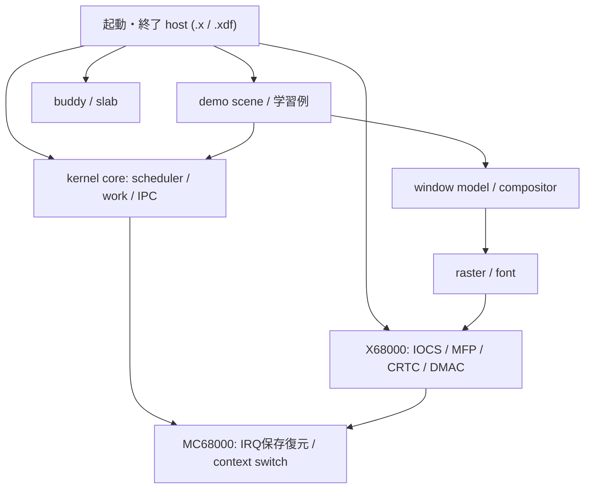

# 教育用 SSOS の設計方針

2026-10-13 のコード調査と E02 の header 分離に基づく。現行実装と今後の設計を分けて記す。実装順序・状態は[改善計画](educational-os-plan.md)、現在の API と排他契約は[文書索引](README.md)から参照する。

## 目的と範囲

SSOS は、MC68000 の実行状態、タスク切替、割り込み、メモリ管理、通信、画面合成を実装から学ぶ小型 OS とする。学習者が「誰が状態を持ち、いつ変更でき、どう検証するか」を説明できることを設計の評価基準にする。

現行は単一 CPU、共有アドレス空間、Supervisor mode のタスクで動く。`.xdf` も IOCS/IPL ROM のサービスを利用する。`.x` は Human68K 上でホスト状態を借りて実行する。このため、タスクをメモリ保護された user process として説明しない。プロセス分離、SMP、汎用ドライバ framework、ファイルシステム、ネットワークは当面の改善対象に含めない。

2 つの方式を一つのソースツリーで比較できること、32 worker slot と固定 stack pool、静的 queue の小ささは教材の利点である。拡張性のためだけに動的登録や抽象層を増やさない。

## 現行の良い基盤と保守上の課題

| 対象 | コードから確認できる現状 | 改善の狙い |
| --- | --- | --- |
| scheduler | `scheduler.c` を共有し、方式別の assembly と `wakeups.c` を選択 | policy と CPU の保存・復帰機構を別々に読む |
| API | 公開 `task.h` と内部 `scheduler.h` を分離済み | application が scheduler 内部を知る必要を減らす |
| hardware | `status.h` / `task.h` / `irq.h` / `clock.h` と内部 `boot.h` / `x68k_mfp.h` に分離済み。DMAC layout は内部 `gfx_hw.h` | 一般 API と X68000 の装置定義を分ける |
| 起動 | `.xdf` の `premain.c` と `app/main.c` に OS 初期化が分散。`.x` は `standalone/main.c` が組み立てる | host が資源を渡す境界と demo の入口を明示する |
| scene | `.x`/`.xdf` の UI は共有。input/wait hook があるが、既定 IOCS 入力も `scene.c` にある | 既存 hook を使って装置依存を外へ出す |
| standalone | 一つの `main.c` に起動、復元、watchdog、primitive/DMA/scene bench、ログ出力がある | 通常実行と計測を独立して理解できるようにする |
| graphics | `vram.c` に RAM 置換可能な raster、font、mode/CRTC、DMA と停止状態がある | 同じ描画アルゴリズムを保ち、装置処理を小さく分ける |
| build | `common-sources.mk` は共有済み。`.x` は work/IPC をリンクしない | 既存の構成差を可視化し、新たな設定軸を増やさない |
| 文書 | 契約資料と詳細な修正履歴があるが、古い起動・描画説明が入口に混在 | 現行仕様、変更計画、履歴を別の役割で維持する |

## 目標とする責務と依存

以下は移行後の責務であり、現在のディレクトリ配置図ではない。矢印は呼出し・依存方向を表す。

- **kernel core** は queue、task lifecycle、sleep、IPC 待ちを管理する。UI、DOS、IOCS、MFP register を参照しない。割り込みのマスク保存復元と CPU 切替入口は、小さな宣言境界から利用する。
- **CPU と装置の実装** は、MC68000 frame/ABI と X68000 の MMIO・ISR 登録を分ける。ISR から scheduler へ入る呼出しは明示した専用境界で扱う。呼出し関係全体を一方向の include 関係と混同しない。
- **host** はメモリ領域、main TCB、初期化順、入力・wait hook、復元・停止を組み立てる。`.x` の DOS I/O と元の状態への復帰、`.xdf` の linker/IPL 初期化はそれぞれに残す。
- **demo** は OS を使う例として扱う。scene の 3 window、drag、本文表示は kernel の起動条件にしない。
- **graphics/window** は UI task 一つが所有する。CPU/RAM raster は実装を共有し、装置境界だけを置換する。host 測定を target の DMA/IRQ 性能値として扱わない。

最初はファイル配置を維持し、header と関数の境界を小さく分ける。移動と挙動変更は別の変更単位にする。仮想関数 table や複数 platform の共通 framework は、具体的な利用先が必要になったときに検討する。

## 公開 API と内部状態

application 用 `task.h` と scheduler 内部の `scheduler.h` を分けた。TCB の layout を隠すことで、学習者は通常 API から入り、必要になった段階で assembly と内部構造を読める。内部を学べなくするための分離ではない。

`SSTaskInfo`、task ID、status、yield/sleep は公開 `task.h`、TCB、ready/sleep queue、`ss_curr_task`、`ss_do_context_switch` は内部 `scheduler.h` に置く。IPC の scheduler 連携と main task 登録は内部境界の利用者とする。既存の `scheduler_abi.h` と `context_frame.h` を layout の正本として維持する。

header 分離では関数 signature と TCB layout を維持した。負エラーを `uint16_t` に符号化する現在の契約は、別の API 改訂として扱う。改訂時は status と ID の分離案も比較し、全 caller・失敗判定・QEMU・target を一括照合する。main IPC、join、slot 再利用の追加とまとめない。

## 起動・所有権・終了の不変条件

現在の規則を今後の分割でも維持する。詳細は[runtime 所有権](runtime-ownership.md)、[task API](task-api-contract.md)、[frame 契約](context-switch-contract.md)が正本である。

1. 独自 ISR の設置前に C の BSS 初期化を完了する。scheduler が利用可能な main TCB を登録するまでは worker を実行させない。
2. task 作成中は INITIALIZING として予約し、canary 完了後に DORMANT を公開する。開始前の slot を READY queue へ入れない。
3. queue を変更する処理は定めた IRQ 契約を守り、各 critical section は自分の saved SR を復元する。yield/sleep で保存する task の SR と、装置の割り込み mask を区別する。
4. allocator は単一所有者または caller の外部排他で使用する。UI/window/GVRAM/DMA は UI 所有者に集約する。work のポインタ payload は callback 完了まで生存させる。
5. `.x` の正常終了と abort は共通の部分初期化・再入対応 cleanup を通す。DMA 停止を確認できなければ表示・source・process 領域を返さず停止する。
6. 通常実行の終了に全画面 checksum を追加しない。計測は明示指定した実行だけで行う。

同優先度は round-robin、異優先度は最高優先度優先である。常時 READY の高優先度 task により低優先度 task が進まない場合がある。yield は低優先度 task の進行保証にはならない。現在は全 task 待機用の idle task がなく、sleep/recv は実行可能 peer がない場合に失敗する。これは API の制限として教え、idle 導入時に契約を改訂する。

## 学習順と確かめる問い

以下は既存コードを読む学習経路である。各行の演習を実行可能な小さな教材へ整える作業は、改善計画 E05 で行う。

| 段階 | 読む入口 | 学習者が説明すること | 検証入口 |
| --- | --- | --- | --- |
| 1. CPU と stack | `tests/asm/t01_hello.s`〜`t05_trap_exception.s` | 呼出し前後の SP、保存 register、SR/PC、rts/rte の違い | `make test-asm` |
| 2. queue と policy | `scheduler.c`、`tests/unit/test_scheduler.c` | 優先度 bitmap と同優先度の選択順。高優先度 task が yield した結果 | `make test` |
| 3. lifecycle と実切替 | `task.h` → 内部 `scheduler.h`、方式別 assembly、frame 契約 | 初回 entry と再開の違い、INITIALIZING/WAIT/TERMINATED、arg/return | `make test-qemu` |
| 4. memory と所有権 | `buddy.c`、`slab.c`、`test_mem.c` | 分割・再結合、最大 block、OOM、固定 stack pool と heap の違い | Native と sanitizer |
| 5. sleep と通信 | `message.c`、`work_queue.c`、QEMU の IPC/work tests | 待ちを READY から外す理由、通知取りこぼし、値コピーと payload 寿命 | Native と QEMU |
| 6. 画面合成 | `window.c`、`scene.c`、`test_scene.c` | 部分更新と全面再描画の一致条件、drag 中の本文保留、z 再採番 | RAM 画素比較 |
| 7. 実機への接続 | `boot/main.s`、`premain.c`、`standalone/main.c` | IOCS/ISR の順序、`.x` の復元、非同期 Timer D と QEMU の差 | 4 成果物の実機確認 |

学習例は production のアルゴリズムを呼び出すか、小さな CPU primitive に限定する。教材専用 scheduler の複製、演習ごとの OS ツリー複製は作らない。予測→実行→観測→説明の順で進め、host test の結果と実機で確認すべき点をそれぞれ記録する。

## 実装済みの header 境界

`kernel.h` の全利用者を移行し、umbrella header は削除した。`task.h` は定数・`SSTaskInfo`・ID による API を提供し、TCB/state/queue と ABI assert は `scheduler.h` に残す。装置の数値や構造 layout は移動だけで変更していない。graphics の mode/page 公開は E02 の互換として維持する。

`make check-includes` は公開 header、scene/replay、scheduler/work/IPC/allocator core の include を間接依存まで検査する。起動 host と CPU port、内部検証は内部 header を利用できる。scene の IOCS 入力は E03 の移行対象なので、現段階では許可する。これは literal include の静的検査であり、macro include・C の全依存・実行時アクセスを解析しない。

## 設計変更の評価

成功の基準は、API 利用者が MMIO/TCB を参照せず例を実装できること、scheduler 変更が UI/IOCS に波及しないこと、学習順に読む入口が一つに定まること、既存の画素・task・終了契約が保たれることである。ファイル数や抽象層の数だけで改善と判定しない。

検証は変更に応じて Native、sanitizer、QEMU、context 比較、両方式・両形式 build を選び、まとまった実装段階で `make verify` を行う。QEMU の同期 trap は実 MFP の任意命令への非同期割り込みを保証しない。残る実機ケースは[既存 N01〜N09 計画](maintenance-performance-plan-2026-09-30.md)で証拠を管理する。
